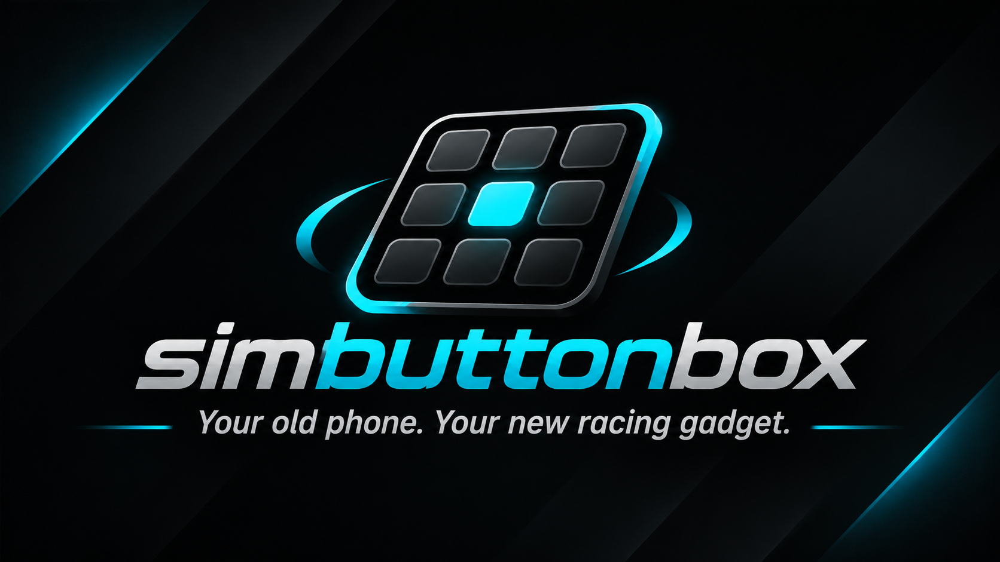



# SimButtonbox

**No extra hardware. No extra cables. Just race.**

Turn your Android phone or tablet into a wireless button box for PC sim racing. The free Windows companion receives commands from your Android device and sends virtual joystick inputs or configured keyboard shortcuts to your PC.

## Download

[Windows releases](https://github.com/standby929/simbuttonbox-release/releases)

The project is currently in testing. The Android app is not yet publicly available on Google Play. If no release is listed, a public Windows build has not yet been uploaded.

## Features

- QR or manual pairing with verification and PIN.
- Multiple Android devices connected simultaneously.
- vJoy and keyboard action mapping.
- Le Mans Ultimate telemetry and supported flag feedback.
- English and Hungarian interface.
- Android Free: fixed Default button group; planned Pro: customizable button groups.

## Getting started

See the [Windows setup guide](INSTALLATION.md). The Windows server must remain running while racing.

## Documentation

[Installation](INSTALLATION.md) · [Changelog](CHANGELOG.md) · [License](LICENSE.txt) · [Privacy information (draft)](PRIVACY.md) · [Third-party notices](THIRD-PARTY-NOTICES.md)

This repository distributes compiled releases and documentation only. SimButtonbox is proprietary software, not an open-source project. Not affiliated with the developers of Le Mans Ultimate or vJoy.

